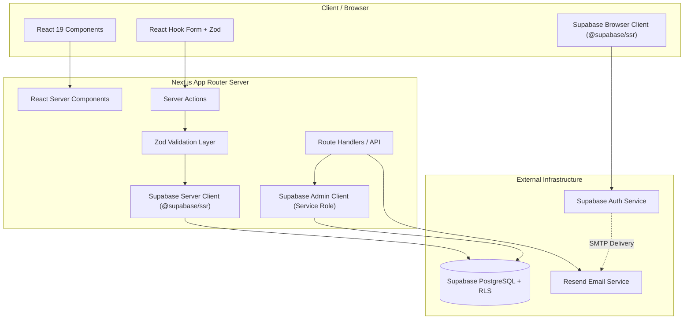

# RankPong — Technical Architecture

## 1. Executive Summary & Tech Stack

RankPong is built on a modern, server-first web stack engineered for performance, strict type safety, real-time consistency, and straightforward scalability.



### Complete Technology Stack
- **Framework**: Next.js (App Router, React 19)
- **Language**: TypeScript (Strict Mode enabled across compiler options)
- **Styling**: Tailwind CSS v4
- **UI Primitives**: shadcn/ui (powered by Base UI)
- **Iconography**: Lucide React
- **Database & Auth**: Supabase PostgreSQL with Row Level Security (RLS) & Supabase Auth
- **Session Management**: `@supabase/ssr` (cookie-based Next.js App Router authentication)
- **Email Delivery**: Resend (integrated with Supabase Auth for transactional verification and notifications)
- **Schema Validation**: Zod (runtime validation for env, form submissions, and server actions)
- **Form Management**: React Hook Form with `@hookform/resolvers/zod`
- **Package Manager**: npm

---

## 2. Core Architectural Principles

1. **Server Components by Default**:
   All UI components are rendered on the server as React Server Components (RSC) unless interactive client state, browser events, or client-side hooks are explicitly required (`"use client"`).
2. **Server-Side Enforcement of Business Logic**:
   No client-side code is trusted to mutate ratings, set scores, or bypass permission checks. All validation, role verification, and ELO calculations execute on the server.
3. **Feature-Oriented Modularity**:
   Code is organized by business domain slices (`features/`) rather than flat technical layers. Each feature encapsulates its own components, actions, schemas, and types.
4. **Clean Presentation vs. Business Logic Separation**:
   Shared components in `components/` are strictly presentational and reusable. They contain no domain-specific business rules or hardcoded data mutations.
5. **Type Safety Across Boundaries**:
   TypeScript types for database entities are synced directly from the Supabase PostgreSQL schema, ensuring zero-drift between database tables and frontend code.
6. **No Premature Abstraction**:
   Components, helpers, and schemas are created to solve immediate, concrete problems without speculative overengineering.

---

## 3. Backend Responsibilities & Service Boundaries

### 3.1 Supabase
- **Authentication**: User sign-up, session issuance, secure password hashing, and token rotation.
- **Relational Database**: PostgreSQL instance hosting tables for profiles, clubs, memberships, matches, and ratings.
- **Row Level Security (RLS)**: Enforces table-level read/write permissions directly in PostgreSQL.
- **Database Functions & Triggers**: Executes atomic transactional operations (e.g., locking player records during rating updates, auto-creating profiles on auth signup).

### 3.2 Next.js Server-Side Code (Server Actions & Route Handlers)
- **Protected Business Operations**: Validating game scores, verifying membership status, orchestrating multi-step workflows.
- **Server Actions**: Preferred interface for data mutations initiated by authenticated users (logging matches, updating profiles, managing club rosters).
- **Route Handlers (`app/api/*`)**: Reserved for webhook ingestion (Resend, Supabase event webhooks) and OAuth redirect callbacks.
- **Data Fetching**: Performed directly in Server Components using authenticated Supabase server clients without an artificial REST abstraction layer.

### 3.3 Resend (Transactional Email)
- Provides transactional email delivery.
- **Supabase Auth Integration**: Configured as the custom SMTP provider for Supabase Auth to dispatch account confirmation and password recovery emails.
- **Application Notifications**: Triggered by Next.js server actions for club invitations and match confirmation alerts.

### 3.4 Security & Privilege Isolation
- **Browser Client**: Initialized with `NEXT_PUBLIC_SUPABASE_URL` and `NEXT_PUBLIC_SUPABASE_ANON_KEY`. Subject to all RLS policies.
- **Server Client**: Initialized dynamically per-request using cookies via `@supabase/ssr`. Subject to RLS policies under the authenticated user's session context.
- **Admin Client**: Initialized exclusively on the server using `SUPABASE_SERVICE_ROLE_KEY`. Bypasses RLS. **NEVER** imported, bundled, or accessible in browser client bundles.

---

## 4. Feature-Oriented Structure

The application features reside in `features/` and follow a consistent internal organization:

```text
features/<feature-name>/
├── components/     # Feature-specific UI components (e.g. MatchCard, ClubHeader)
├── actions/        # Next.js Server Actions for mutations (e.g. logMatchAction)
├── schemas/        # Zod runtime validation schemas for forms and actions
├── types/          # Feature-specific TypeScript interfaces and domain types
└── utils/          # Pure helper functions specific to the domain (e.g. eloEngine)
```

### Domain Feature Breakdown
1. **`features/auth`**:
   - *Components*: `SignInForm`, `SignUpForm`, `ResetPasswordModal`
   - *Actions*: `signUpAction`, `signInAction`, `signOutAction`
   - *Schemas*: `loginSchema`, `registerSchema`, `passwordResetSchema`
   - *Data Access*: Supabase Auth client & profile query
2. **`features/clubs`**:
   - *Components*: `ClubCard`, `ClubRoster`, `ClubSettingsForm`, `InviteMemberDialog`
   - *Actions*: `createClubAction`, `updateClubAction`, `invitePlayerAction`, `reviewJoinRequestAction`
   - *Schemas*: `clubCreationSchema`, `inviteSchema`, `clubSettingsSchema`
   - *Data Access*: `clubs`, `club_members`, `club_invitations` tables
3. **`features/players`**:
   - *Components*: `PlayerAvatar`, `PlayerBioCard`, `HeadToHeadStats`
   - *Actions*: `updateProfileAction`, `uploadAvatarAction`
   - *Schemas*: `profileUpdateSchema`
   - *Data Access*: `profiles` table
4. **`features/matches`**:
   - *Components*: `MatchForm`, `MatchScoreCard`, `PendingMatchBanner`, `SetScoreInputs`
   - *Actions*: `submitMatchAction`, `confirmMatchAction`, `disputeMatchAction`
   - *Schemas*: `matchSubmissionSchema`, `setScoreSchema`
   - *Data Access*: `matches`, `match_sets` tables
5. **`features/rankings`**:
   - *Components*: `GlobalLeaderboardTable`, `ClubLadderTable`, `EloHistoryChart`
   - *Actions*: `recalculateRatingAction`
   - *Utils*: `calculateEloDelta`, `calculateExpectedScore`
   - *Data Access*: `rating_history` table & materialized views
6. **`features/competitions`** *(Planned for Phase 5)*:
   - *Components*: `TournamentBracket`, `LeagueStandingsTable`, `FixtureList`
   - *Actions*: `createTournamentAction`, `generateFixturesAction`
   - *Schemas*: `competitionSchema`
   - *Data Access*: `competitions`, `competition_members`, `competition_matches`
