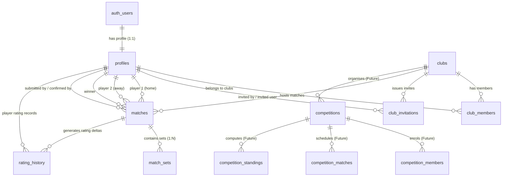

# RankPong — Data Model Specification

## 1. Overview & Entity-Relationship Architecture

The RankPong database schema is built on PostgreSQL hosted via Supabase. It uses strict relational constraints, UUID primary keys, foreign key cascading rules, and check constraints to guarantee data integrity across clubs, matches, and rating histories.

### High-Level Entity Relationship Diagram (ERD)

---

## 2. Core Entities (MVP Phase)

### 2.1 `profiles`
- **Purpose**: Stores global user profile information and competitive statistics. Linked 1:1 with Supabase Auth (`auth.users.id`).
- **Primary Key**: `id UUID REFERENCES auth.users(id) ON DELETE CASCADE`
- **Fields**:
  - `username TEXT UNIQUE NOT NULL` — Lowercase alphanumeric identifier.
  - `full_name TEXT NOT NULL` — Display name.
  - `avatar_url TEXT NULL` — Remote storage URL for avatar image.
  - `bio TEXT NULL` — Short user description.
  - `handedness TEXT NULL` — `CHECK (handedness IN ('right', 'left'))`.
  - `play_style TEXT NULL` — `CHECK (play_style IN ('attacker', 'defender', 'allround'))`.
  - `grip_type TEXT NULL` — `CHECK (grip_type IN ('shakehand', 'penhold'))`.
  - `elo_rating INTEGER NOT NULL DEFAULT 1000` — Global universal rating baseline.
  - `matches_played INTEGER NOT NULL DEFAULT 0` — Lifetime match count.
  - `matches_won INTEGER NOT NULL DEFAULT 0` — Lifetime victory count.
  - `created_at TIMESTAMPTZ NOT NULL DEFAULT NOW()`
  - `updated_at TIMESTAMPTZ NOT NULL DEFAULT NOW()`
- **Constraints**:
  - `elo_rating >= 100` (safety lower bound).
  - `matches_won <= matches_played`.

### 2.2 `clubs`
- **Purpose**: Represents an individual table tennis club or community.
- **Primary Key**: `id UUID DEFAULT gen_random_uuid()`
- **Fields**:
  - `name TEXT NOT NULL` — Club display name.
  - `slug TEXT UNIQUE NOT NULL` — URL-friendly unique identifier (e.g. `/clubs/acme-spin`).
  - `description TEXT NULL` — Public club description.
  - `logo_url TEXT NULL` — Club avatar/logo image URL.
  - `owner_id UUID NOT NULL REFERENCES profiles(id) ON DELETE RESTRICT` — Creator/current owner.
  - `is_private BOOLEAN NOT NULL DEFAULT TRUE` — Whether private membership is enforced.
  - `location TEXT NULL` — Physical venue or city.
  - `member_count INTEGER NOT NULL DEFAULT 1` — Denormalized count for fast public discovery.
  - `created_at TIMESTAMPTZ NOT NULL DEFAULT NOW()`
  - `updated_at TIMESTAMPTZ NOT NULL DEFAULT NOW()`
- **Relationships**:
  - `owner_id` links to `profiles.id`.

### 2.3 `club_members`
- **Purpose**: Join table establishing a user's membership and role in a specific club. Allows users to belong to multiple clubs with distinct roles.
- **Primary Key**: `id UUID DEFAULT gen_random_uuid()`
- **Fields**:
  - `club_id UUID NOT NULL REFERENCES clubs(id) ON DELETE CASCADE`
  - `user_id UUID NOT NULL REFERENCES profiles(id) ON DELETE CASCADE`
  - `role TEXT NOT NULL DEFAULT 'member'` — `CHECK (role IN ('owner', 'admin', 'member'))`
  - `status TEXT NOT NULL DEFAULT 'pending'` — `CHECK (status IN ('pending', 'active', 'rejected', 'banned', 'left'))`
  - `joined_at TIMESTAMPTZ NULL` — Timestamp when membership became active.
  - `created_at TIMESTAMPTZ NOT NULL DEFAULT NOW()`
  - `updated_at TIMESTAMPTZ NOT NULL DEFAULT NOW()`
- **Constraints**:
  - `UNIQUE (club_id, user_id)` — A user can only have one membership record per club.

### 2.4 `club_invitations`
- **Purpose**: Tracks invitation links and email invites issued by club owners or administrators.
- **Primary Key**: `id UUID DEFAULT gen_random_uuid()`
- **Fields**:
  - `club_id UUID NOT NULL REFERENCES clubs(id) ON DELETE CASCADE`
  - `invited_by UUID NOT NULL REFERENCES profiles(id) ON DELETE CASCADE`
  - `invited_email TEXT NULL` — Targeted invitee email (if sent via email).
  - `token TEXT UNIQUE NOT NULL` — Secure random invitation token.
  - `role TEXT NOT NULL DEFAULT 'member'` — Pre-assigned role upon acceptance.
  - `expires_at TIMESTAMPTZ NOT NULL` — Expiration deadline (typically 7 days).
  - `accepted_at TIMESTAMPTZ NULL` — Timestamp of redemption.
  - `created_at TIMESTAMPTZ NOT NULL DEFAULT NOW()`
- **Constraints**:
  - `expires_at > created_at`

---

## 3. Matches & Rating Entities (MVP Phase)

### 3.1 `matches`
- **Purpose**: Records individual head-to-head singles matches played within a club.
- **Primary Key**: `id UUID DEFAULT gen_random_uuid()`
- **Fields**:
  - `club_id UUID NOT NULL REFERENCES clubs(id) ON DELETE CASCADE`
  - `player1_id UUID NOT NULL REFERENCES profiles(id) ON DELETE RESTRICT`
  - `player2_id UUID NOT NULL REFERENCES profiles(id) ON DELETE RESTRICT`
  - `category TEXT NOT NULL` — `CHECK (category IN ('friendly', 'ranked'))`
  - `status TEXT NOT NULL DEFAULT 'pending_confirmation'` — `CHECK (status IN ('pending_confirmation', 'confirmed', 'disputed', 'voided'))`
  - `player1_sets_won INTEGER NOT NULL DEFAULT 0`
  - `player2_sets_won INTEGER NOT NULL DEFAULT 0`
  - `winner_id UUID NULL REFERENCES profiles(id) ON DELETE RESTRICT`
  - `submitted_by UUID NOT NULL REFERENCES profiles(id) ON DELETE RESTRICT`
  - `confirmed_by UUID NULL REFERENCES profiles(id) ON DELETE RESTRICT`
  - `played_at TIMESTAMPTZ NOT NULL DEFAULT NOW()`
  - `confirmed_at TIMESTAMPTZ NULL`
  - `created_at TIMESTAMPTZ NOT NULL DEFAULT NOW()`
  - `updated_at TIMESTAMPTZ NOT NULL DEFAULT NOW()`
- **Constraints**:
  - `CHECK (player1_id <> player2_id)` — A player cannot play against themselves.
  - `CHECK (winner_id IS NULL OR winner_id IN (player1_id, player2_id))`
  - `CHECK (submitted_by IN (player1_id, player2_id))`

### 3.2 `match_sets`
- **Purpose**: Stores granular set scores for a match (e.g. Set 1: 11-9, Set 2: 8-11, Set 3: 11-7).
- **Primary Key**: `id UUID DEFAULT gen_random_uuid()`
- **Fields**:
  - `match_id UUID NOT NULL REFERENCES matches(id) ON DELETE CASCADE`
  - `set_number INTEGER NOT NULL` — 1, 2, 3, 4, 5.
  - `player1_score INTEGER NOT NULL`
  - `player2_score INTEGER NOT NULL`
  - `created_at TIMESTAMPTZ NOT NULL DEFAULT NOW()`
- **Constraints**:
  - `UNIQUE (match_id, set_number)`
  - `CHECK (player1_score >= 0 AND player2_score >= 0)`
  - `CHECK (player1_score <> player2_score)` — No tied sets allowed.

### 3.3 `rating_history`
- **Purpose**: Immutable audit log of all global ELO adjustments. One record per player per confirmed ranked match.
- **Primary Key**: `id UUID DEFAULT gen_random_uuid()`
- **Fields**:
  - `match_id UUID NOT NULL REFERENCES matches(id) ON DELETE RESTRICT`
  - `player_id UUID NOT NULL REFERENCES profiles(id) ON DELETE RESTRICT`
  - `old_rating INTEGER NOT NULL`
  - `new_rating INTEGER NOT NULL`
  - `rating_delta INTEGER NOT NULL` — Difference ($new\_rating - old\_rating$).
  - `calculated_at TIMESTAMPTZ NOT NULL DEFAULT NOW()`
- **Constraints**:
  - `UNIQUE (match_id, player_id)` — A player only receives one rating delta per match.
  - `CHECK (rating_delta = new_rating - old_rating)`

---

## 4. Future Entities (Phase 5 Competitions)

*Note: The following tables are formally architected for forward-compatibility, but their implementation is deferred to Phase 5.*

### 4.1 `competitions`
- **Purpose**: Organises leagues, tournaments, and seasonal events inside a club.
- **Fields**:
  - `id UUID PRIMARY KEY DEFAULT gen_random_uuid()`
  - `club_id UUID NOT NULL REFERENCES clubs(id) ON DELETE CASCADE`
  - `name TEXT NOT NULL`
  - `type TEXT NOT NULL` — `CHECK (type IN ('league', 'tournament_single_elim', 'tournament_double_elim', 'season'))`
  - `status TEXT NOT NULL` — `CHECK (status IN ('draft', 'registration', 'in_progress', 'completed', 'archived'))`
  - `affects_global_elo BOOLEAN NOT NULL DEFAULT FALSE` — Configurable ELO toggle.
  - `scoring_rules JSONB NOT NULL DEFAULT '{}'` — Points per win/draw/loss for leagues.
  - `start_date DATE NULL`, `end_date DATE NULL`

### 4.2 `competition_members`
- **Purpose**: Participants enrolled in a specific tournament or league.
- **Fields**: `id UUID PRIMARY KEY`, `competition_id UUID REFERENCES competitions(id)`, `user_id UUID REFERENCES profiles(id)`, `seed_number INTEGER NULL`, `status TEXT`.

### 4.3 `competition_matches`
- **Purpose**: Connects match records to competition stages, rounds, and bracket nodes.
- **Fields**: `id UUID PRIMARY KEY`, `competition_id UUID REFERENCES competitions(id)`, `match_id UUID REFERENCES matches(id)`, `round_number INTEGER NOT NULL`, `bracket_position TEXT NULL`.

### 4.4 `competition_standings`
- **Purpose**: Materialized or computed standing points, goal differential, and ranking positions for a competition, completely independent of global ELO.
- **Fields**: `id UUID PRIMARY KEY`, `competition_id UUID REFERENCES competitions(id)`, `player_id UUID REFERENCES profiles(id)`, `rank INTEGER`, `points INTEGER`, `played INTEGER`, `won INTEGER`, `lost INTEGER`.

---

## 5. MVP vs. Future Scope Matrix

| Entity | MVP (Phase 1–4) | Future (Phase 5+) | Reason for Boundary |
|---|:---:|:---:|---|
| `profiles` | **Included** | — | Core user identity & global ELO |
| `clubs` | **Included** | — | Core community boundary |
| `club_members` | **Included** | — | Role-based club authorization |
| `club_invitations` | **Included** | — | Onboarding new club members |
| `matches` | **Included** | — | Singles match logging & verification |
| `match_sets` | **Included** | — | Detailed set scores (11-9, etc.) |
| `rating_history` | **Included** | — | Auditable ELO tracking |
| `doubles_matches` | Deferred | **Included** | Singles prioritised first |
| `competitions` | Deferred | **Included** | Complex bracket generation deferred |
| `competition_members` | Deferred | **Included** | Dependent on competitions |
| `competition_standings` | Deferred | **Included** | Dependent on competitions |
